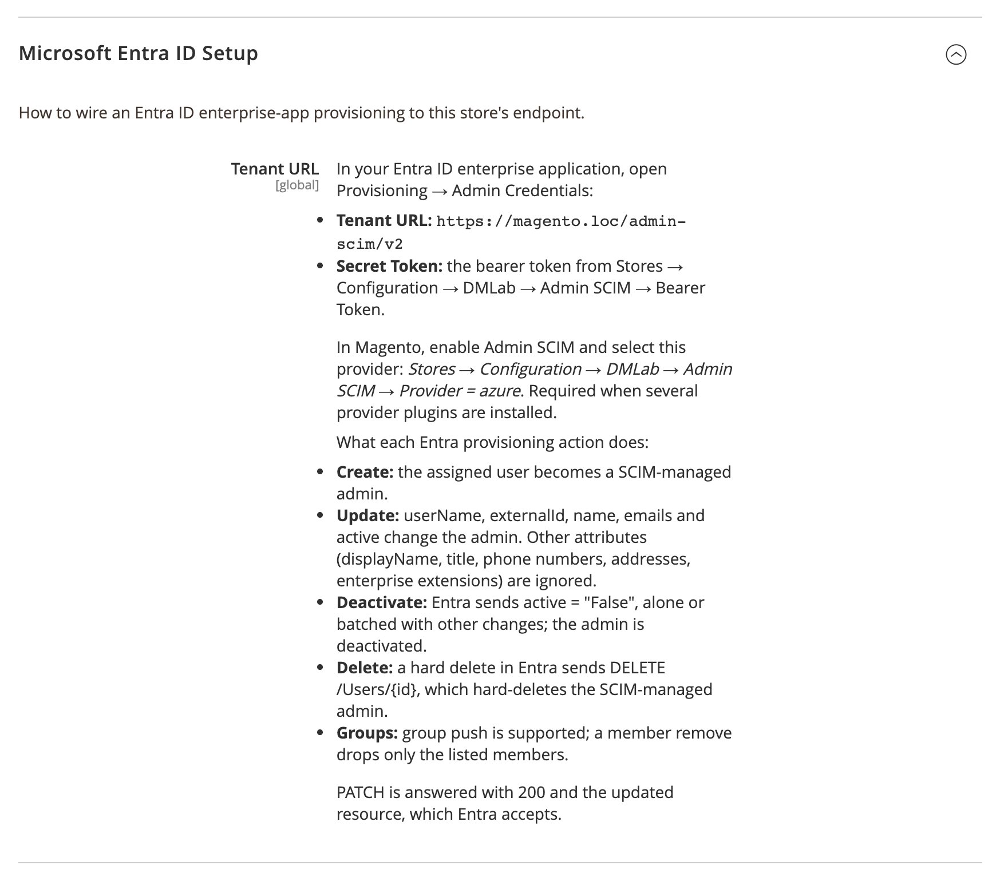

# DmLab_AdminScimAzure

> Microsoft Entra ID SCIM provisioning for Magento 2 admin users.

[](https://github.com/dmlab-work/module-admin-scim-azure/actions/workflows/ci.yml) [](https://codecov.io/gh/dmlab-work/module-admin-scim-azure) [](https://packagist.org/packages/dmlab/module-admin-scim-azure) [](https://packagist.org/packages/dmlab/module-admin-scim-azure) [](https://packagist.org/packages/dmlab/module-admin-scim-azure) [](LICENSE) 

Automatic admin offboarding for Microsoft Entra ID.
When IT removes a user in Entra, the Magento admin account is deactivated on Entra's next provisioning cycle, and new hires get the right role before they log in.
Access-control evidence for SOC 2 / ISO 27001.



## Install

```bash
composer require dmlab/module-admin-scim-azure
bin/magento module:enable DmLab_AdminScim DmLab_AdminScimAzure
bin/magento setup:upgrade
```

The `require` pulls `dmlab/module-admin-scim` — the whole provisioning chain installs at once.

## Set up the Entra SCIM app

1. In Magento, open **Stores → Configuration → DMLab → Admin SCIM**, enable Admin SCIM, and set a **Bearer Token**.
   Set **Admin SCIM → Provider = azure** — required when several provider plugins are installed.
2. Read the Tenant URL from **Stores → Configuration → DMLab → Admin SCIM → Microsoft Entra ID Setup**. It is this store's SCIM base URL, e.g. `https://your-host/admin-scim/v2`.
3. In Entra, create an enterprise application, then under **Provisioning → Admin Credentials** enter:

   | Setting | Value |
   |---|---|
   | Tenant URL | the URL from step 2 |
   | Secret Token | the Bearer Token from step 1 |

4. Set the provisioning **Mapping** and **Scope**, then enable provisioning and assign users/groups.

## Requirements

Magento 2.4.7+ · PHP 8.2–8.5 · `dmlab/module-admin-scim` ^0.2.0 (installed automatically) · store reachable by Entra over HTTPS

Pairs with [dmlab/module-admin-sso-azure](https://github.com/dmlab-work/module-admin-sso-azure) — Entra login to the admin panel; this module creates, updates and deactivates the accounts in the background.

## Supported provisioning actions

Only SCIM-managed admins (created via SCIM) are touched.

- **Create** — Entra pushes a new user → admin_user created.
- **Update** — `userName`, `externalId`, `name` (`givenName`, `familyName`, `formatted`), `emails` and `active` change the admin. Other attributes (`displayName`, `title`, `preferredLanguage`, phone numbers, addresses, enterprise and other extension attributes) are accepted and ignored.
- **Deactivate / reactivate** — `active: "False"` / `"True"`, alone or batched with other changes. Unassigning the user or a soft delete in Entra deactivates.
- **Delete** — a hard delete in Entra sends `DELETE /Users/{id}`, which hard-deletes the SCIM-managed admin.
- **Group push** — group membership → role mapping; a member remove drops only the listed members.

## Architecture

Entra pushes SCIM 2.0 requests to the `admin-scim` endpoint. This plugin registers `AzureRequestNormalizer` into `admin-scim`'s `RequestNormalizerInterface` seam under the provider code `azure`; the core invokes it only when the configured provider is `azure` (or it is the only registered normalizer and none is selected). Provisioning and role mapping happen in `admin-scim`.

Rewritten by `AzureRequestNormalizer` into the canonical RFC form:

- **Core-URN-qualified attributes** — `urn:ietf:params:scim:schemas:core:2.0:User:attr` (or `.attr`) in a PATCH `path`, a path-less `value` key or a POST/PUT key becomes the bare `attr`.
- **Group-member remove by value** — Entra puts the members in the op's `value` instead of a `path` filter (RFC §3.5.2.2). Rewritten to one `members[value eq "<id>"]` remove per member; an empty `value` list removes nobody (the core would clear the group).

Accepted natively by the core, passed through unchanged:

- extension attributes (e.g. the enterprise User URN), flat or nested — ignored;
- `emails[type eq "work"].value` — sets the email;
- stringified booleans (`"False"`, `"True"`);
- `Add` / `Replace` used interchangeably, capitalized op names;
- PATCH answered with `200` and the updated resource, which Entra accepts.

## License

[OSL-3.0](LICENSE) © DMLab. Commercial licensing and support: <https://dmlab.work>.
